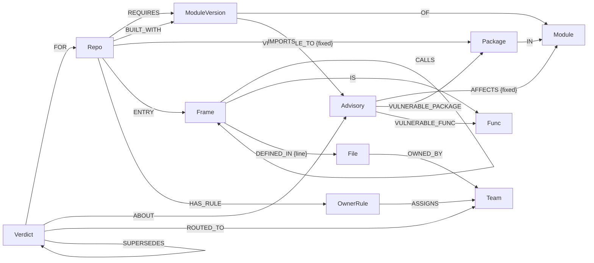

# Clearance

**A new Go vulnerability lands. Clearance tells you which of your services are really affected, and proves which ones are not.**

For every service in a fleet, Clearance gives one of two answers:

- **affected**, with the call path from the service's own code into the vulnerable function, the file and line where its code touches the dependency, the CODEOWNERS team that owns that file, and the version to bump to; or
- **not affected**, with the proof: there is no path. That proof goes straight into an [OpenVEX](https://github.com/openvex/spec) statement.

Everything lives in one FalkorDB graph: the services, the module versions they build with, the advisories, the vulnerable functions, the call chains and the owning teams. A verdict is a graph query. Take the graph away and there is no verdict.

Built during Graph Hacks (WeMakeDevs x FalkorDB), Oct 15-18 2026. Tracks: **Agents That Act on Connected Data** and **Company Brain**.

**Live demo: [clearance-lemon.vercel.app](https://clearance-lemon.vercel.app)** (Vercel + FalkorDB Cloud).

## What it found on a real fleet

Clearance was pointed at 20 of Grafana's open-source Go services (k6, Loki, Tempo, Mimir, Pyroscope, Alloy, Beyla and others), each pinned to an exact commit ([`fleet.lock.json`](fleet.lock.json)).

| | |
|---|---|
| Alerts a version-only scanner raises (repo × advisory) | **278** |
| Proven **not affected**: no call path reaches the vulnerable code | **65** |
| **Affected**, each with a call path | **195** (183 from shipped code, 12 only from example code) |
| Under investigation: the reachability scan of that repo failed, so nothing is claimed | **18** |
| Pull requests that close every affected verdict | **14**, across 10 CODEOWNERS teams |

One advisory from the week of the event, [GO-2026-6609](https://pkg.go.dev/vuln/GO-2026-6609) (no limit on parsed Range headers in `net/http`): a version-only scanner flags 11 services. The graph proves 7 are not affected, routes 3 to their owners (one of them only reachable through k6's `examples/secrets/mock_server.go`), and leaves 1 open.

## How a verdict is decided

1. **Blast radius.** OSV says which module versions an advisory's range covers. Every repo with a `REQUIRES` (or, for the standard library, `BUILT_WITH`) edge to one of those versions is a candidate. This is what a version-only scanner reports.
2. **Reachability.** [govulncheck](https://go.dev/doc/security/vuln/) ran on each repo at its pinned commit and declared toolchain ([`scripts/scan.sh`](scripts/scan.sh)). Its call stacks are loaded as `Frame` nodes that belong to that repo, joined by `CALLS` edges. If `shortestPath` finds a path from one of the repo's entry points to a frame govulncheck reported as a vulnerable call of a function the advisory names, the repo is **affected**, and the shortest path from shipped code is the evidence.
3. **No path.** If the repo imports the vulnerable package but no path reaches the vulnerable functions, it is **not affected** (`vulnerable_code_not_in_execute_path`). If it only requires the module and never imports the package, it is **not affected** (`vulnerable_code_not_present`).
4. **Never guess.** If a repo's scan failed, or the advisory is newer than the vulnerability database the scan used, the verdict is **under investigation** and says why.
5. **Route.** Walking back from the vulnerable function, the first frame in the repo's own code is the call site. Its file resolves through CODEOWNERS (last match wins) to a team.
6. **Remember.** Each verdict is stored as a `Verdict` node. When the facts change (a new commit, a modified advisory, a different path), a new verdict `SUPERSEDES` the old one, so the history of what was decided, when and on which commit stays in the graph.

The model never decides a verdict. Verdicts come from the graph; the agent only reads them.

## Graph data model



| Node | Key properties |
|---|---|
| `Repo` | `name`, `sha` (pinned commit), `module`, `stdlib` (declared toolchain), `scanOk`, `scanNote` |
| `Module`, `ModuleVersion` | `path`; `key` = `path@version` |
| `Advisory` | `id` (Go vulndb), `summary`, `published`, `modified`, `aliases` |
| `Package`, `Func` | Go package path; `key` = `package.Receiver.Name` |
| `Frame` | a function as it appears in one repo's call chains: `key` = `repo|func`, `vulnerable` = govulncheck reported it as the vulnerable call |
| `File`, `Team`, `OwnerRule` | file path in a repo; CODEOWNERS team handle; CODEOWNERS pattern |
| `Verdict` | `status`, `justification`, `reason`, `path`, `callSite`, `file`, `owners`, `bumps`, `reach`, `decidedAt`, `supersededAt`, `current` |

`CALLS` edges are govulncheck's evidence (the call stacks it found toward vulnerable code), not a full call graph. Frames of different repos never connect, so a path query for one repo cannot wander into another's chains. Only CODEOWNERS **teams** are stored; handles of individual people are dropped at ingest.

## The Cypher it depends on

Candidates, the version-only blast radius ([`src/graph/verdicts.ts`](src/graph/verdicts.ts)):

```cypher
MATCH (r:Repo)-[:REQUIRES|BUILT_WITH]->(v:ModuleVersion)-[m:VULNERABLE_TO]->(a:Advisory)
RETURN r.name AS repo, a.id AS advisory,
       collect(v.path + '@' + v.version + '=>' + coalesce(m.fixed, '')) AS bumps
```

Affected: a call path inside one repo's call edges, from an entry point to a function the advisory names:

```cypher
MATCH (:Advisory {id: $advisory})-[:VULNERABLE_FUNC]->(:Func)<-[:IS]-(t:Frame {repo: $repo, vulnerable: true})
MATCH (:Repo {name: $repo})-[:ENTRY]->(e:Frame)
WITH e, shortestPath((e)-[:CALLS*1..30]->(t)) AS p
WHERE p IS NOT NULL
OPTIONAL MATCH (e)-[:DEFINED_IN]->(file:File)
WITH p, length(p) AS hops, file.path AS entryFile, reduce(s = '', n IN nodes(p) | s + n.func + ' ') AS sig
RETURN [n IN nodes(p) | n.func] AS path, [n IN nodes(p) | n.module] AS modules, entryFile, hops
ORDER BY hops, sig LIMIT 200
```

An earlier version listed every path with `[:CALLS*0..30]` and sorted them. On `net/http`'s branching call chains that took a 100 MB FalkorDB Cloud instance down; `shortestPath` is a breadth-first search per entry and target, so it stays small.

Not affected, imported but unreached:

```cypher
MATCH (:Repo {name: $repo})-[:IMPORTS]->(p:Package)<-[:VULNERABLE_PACKAGE]-(:Advisory {id: $advisory})
RETURN p.path AS pkg LIMIT 1
```

Owner of the call site:

```cypher
MATCH (:Frame {key: $repo + '|' + $key})-[:DEFINED_IN]->(file:File)
OPTIONAL MATCH (file)-[:OWNED_BY]->(t:Team)
RETURN file.path AS file, collect(t.handle) AS owners
```

Where a repo's own code calls into a package ([`src/graph/fleet.ts`](src/graph/fleet.ts)):

```cypher
MATCH (c:Frame)-[:CALLS]->(d:Frame) WHERE d.package STARTS WITH $pkg
MATCH (c)-[l:DEFINED_IN]->(file:File)
OPTIONAL MATCH (file)-[:OWNED_BY]->(t:Team)
RETURN c.repo AS repo, file.path AS file, l.line AS line, collect(DISTINCT t.handle) AS teams
```

The fix plan, the team inbox, the verdict history and the canvas view are in [`src/graph/fleet.ts`](src/graph/fleet.ts) and [`src/app.ts`](src/app.ts).

## The agent

The Ask tab is a triage agent (OpenAI, `gpt-5.4-mini` by default). It picks from read-only graph tools: `fleet_summary`, `list_advisories`, `blast_radius`, `evidence`, `repo_verdicts`, `fix_plan`, `team_inbox`, `call_sites`, and `run_cypher` for questions the others don't cover. Every answer lists the tools it used.

- Every query goes through `GRAPH.RO_QUERY`, so no tool can change the graph, and the model never sees database credentials.
- `run_cypher` gets a 5-second FalkorDB timeout and a 50-row cap; each model call gets 60 seconds.
- "Under investigation" is never presented as safe; verdicts reachable only from examples or tests are called out as lower priority.
- On the public demo the Ask tab is capped per visitor and per day. The counters live in the same FalkorDB server, and visitor IPs are stored only as salted hashes that expire.

## Outputs

- **OpenVEX** per repo (`/api/vex/<repo>`): one statement per advisory, `not_affected` with its justification and impact statement, `affected` with the action, `under_investigation` with the reason.
- **Issue draft** per affected verdict (`/api/issue/<repo>/<advisory>`): the call path with links to the pinned commit, the owning team, and the bump. Drafts are for copying; Clearance never posts anything.

## Run it locally

Needs Docker and Node 24.

```sh
docker compose up -d          # FalkorDB 6.0.2 on 6379, FalkorDB Browser on http://localhost:3000 (the live demo runs on FalkorDB Cloud)
npm install
cp .env.example .env          # add OPENAI_API_KEY for the Ask tab; everything else works without it
npm run ingest                # repos at pinned commits, go.mod, CODEOWNERS, OSV + Go vulndb, data/scans
npm run decide                # verdicts
npm run build && npm start    # http://localhost:8080
```

- Change the fleet in [`fleet.json`](fleet.json), then `npm run pin` to pin each repo to its current head.
- Rescan reachability on Linux with Go, jq and govulncheck: `scripts/scan.sh fleet.lock.json data/scans`. The committed scans in [`data/scans`](data/scans) were made with govulncheck v1.9.0 and the Go vulndb of 2026-10-08.
- `npm test` runs the unit tests; `npm run typecheck` checks the server and the web app.

## Data, and what it does not claim

- All data is public: Grafana's repositories at pinned commits, OSV, and the Go vulnerability database. No personal data: CODEOWNERS entries for individual people are dropped, and only team handles are stored.
- Reachability is only as good as govulncheck's static analysis. Function-level data exists only for Go, which is why the fleet is Go.
- Standard-library verdicts assume the Go toolchain declared in each repo's `go.mod`. A release pipeline that builds with a newer Go may already be fixed.
- `./...` includes example and test programs. A path that starts only in `examples/`, `tests/`, `tools/` and similar directories is marked `examples_tests_only`.
- Two scans failed and are reported as under investigation instead of guessed: Alloy (govulncheck ran out of memory at 31 GB on `./...`, and its shipped binary is built from a separate `collector/` module) and Beyla (its packages need `go generate` for eBPF code before they type-check).

## Built with AI assistance

As the rules ask: I built Clearance with an AI coding assistant (Claude Code). I chose the problem and the design, reviewed the code, ran every step against the real data, and can explain the graph model, the queries and each decision.

## License

MIT
